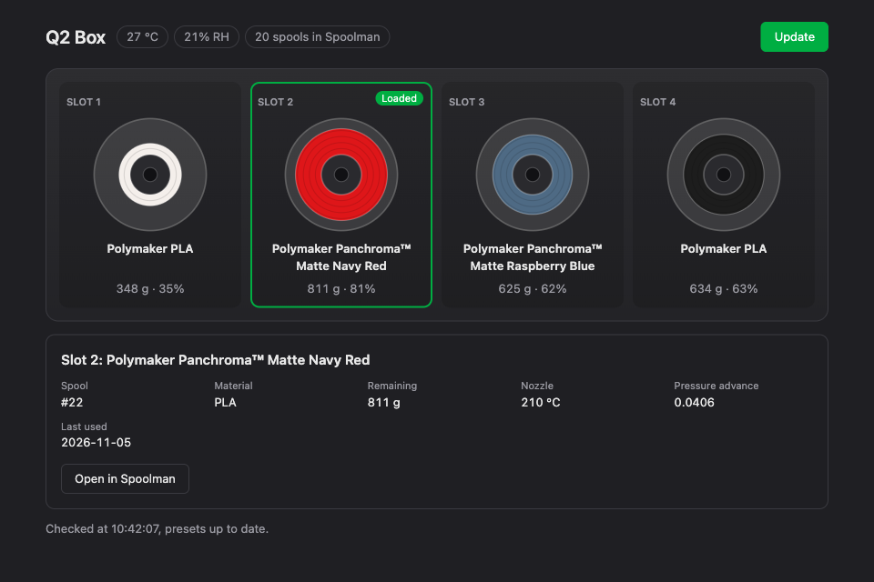

# q2-offload

Run **mainline Klipper** for a **Qidi Q2 + Qidi Box** on a small computer next to the
printer (a mini PC, a NAS, a Raspberry Pi 4/5). The printer's own board keeps the touchscreen
and the camera, and forwards its three microcontroller links over the network.

**[Documentation](https://cedbossneo.github.io/q2-offload/docs/)** ·
**[Project page](https://cedbossneo.github.io/q2-offload/)**

Everything is configured: the Klipper configuration for the Q2 (load cell probing, adaptive
bed mesh), Happy Hare for the Qidi Box (NFC tags → Spoolman with SpoolmanDB data, a load cell
pressure advance calibration offered for each new filament, drying with keep-dry and spool
rotation, a dialog to retry a failed load), purge bucket and chute macros, power-loss
recovery, Mainsail and Fluidd, HelixScreen on the touchscreen, failure detection with Obico's
detector, and an OrcaSlicer integration: the slicer sees the Box and selects the preset of
the exact spool in each slot.



## Install

Read [Before you start](https://cedbossneo.github.io/q2-offload/docs/start/before-you-start/)
and [What you need](https://cedbossneo.github.io/q2-offload/docs/start/requirements/), then
follow the [install guide](https://cedbossneo.github.io/q2-offload/docs/install/prepare-host/).
In short, on a Debian or Ubuntu host, as your normal user:

```sh
git clone https://github.com/cedbossneo/q2-offload.git ~/q2-offload
cd ~/q2-offload
git checkout "$(git tag -l 'v*' --sort=-creatordate | grep -v -- -beta | head -1)"  # latest stable
./install.sh --printer 192.168.1.50
```

> [!CAUTION]
> This replaces Qidi's firmware on three microcontrollers. The **first** conversion
> replaces Qidi's bootloader with Katapult: a power cut during that step, or a wrong
> image, can only be recovered with an ST-Link. Going back to Qidi's firmware does not
> need one. No warranty (GPL-3.0); you do this at your own risk.

The documentation is also in [`docs/`](docs/index.md), readable here on GitHub.

## Credits and license

Built on the work of MisterSheikh, n3oney, endeavour, theboleslaw and Qidi, and on Klipper,
Moonraker, Katapult, Happy Hare, Spoolman, HelixScreen, Mainsail, Fluidd, autopa, Obico and
Apprise: see [Credits and license](docs/reference/credits.md). GPL-3.0.
