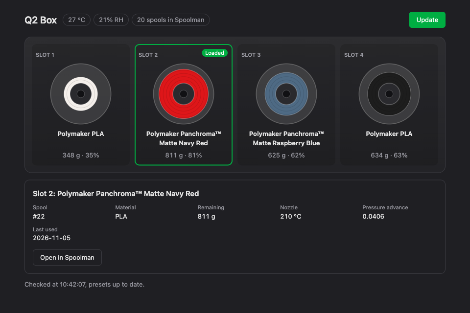

You need **OrcaSlicer 2.5 or newer** (printing through the printer needs fixes that are not
in 2.4). The presets are in the repository, in `slicer/orca/`.

## Presets and connection

1. **Add the stock Qidi Q2 printer once.** In OrcaSlicer, add the **Qidi Q2 0.4 nozzle**
   printer: q2-offload's presets build on it.

2. **Import the presets.** Download the
   [six preset files](../../slicer/orca), then **File → Import → Import Configs…** and select
   them: the printer, the 0.20 mm process, and filament templates for PLA, PETG, ABS and TPU.

3. **Connect to the printer.** Select the **Q2 Offload 0.4 nozzle** printer, click the Wi-Fi
   icon next to it, set the host type to **Octo/Klipper** and the host to
   `http://<your-host>`, **without a port**.

4. **Turn on printer agents**, in Orca's developer settings (**Use printer agents**). Orca
   can then read the Box: **Sync filaments** fills each slot with its colour and material, and
   the print dialog lets you choose a slot per filament.

5. **Set one filament per Box gate** (T0 to T3). For your own filaments, start from one of
   the templates.

## The Box tab

The **Q2 Spool Presets** plugin adds a **Q2 Box** tab, and gives OrcaSlicer one preset per
spool in Spoolman, with its own flow ratio and pressure advance.

1. Download [`q2_spool_presets.py`](../../slicer/orca/plugins/q2_spool_presets.py).
2. **Plugins → Install local plugin**, select it, and enable it.
3. The first time, Orca blocks its network access while it asks: answer **Yes**, then click
   **Update**.
4. Run **Sync filaments** without "Color only": each slot gets the preset of its spool.

The tab shows each spool with what is left on it, and the Box temperature and humidity. It
installs the presets on its own when the printer connects and while the tab is open.

That's it: slice, send, print.

> [!TIP]
> Print the files through the printer (upload from Orca, Mainsail or Fluidd), not from a USB
> stick: Happy Hare reads the colours and tool changes when the file arrives.

Without a Box

Set the printer agent to `moonraker` and slice with one filament: there are no slots to sync
or choose, and T1 to T3 stop the print.

OrcaSlicer says it cannot connect

- **Keep the address without `:7125`.** Without an access code the agent sends a placeholder
  that Moonraker rejects; the host's web server drops it, so go through it, not straight to
  Moonraker.
- **A printer that used the `moonraker` agent before** keeps looking under it. Close Orca, and
  in `OrcaSlicer.conf`, under `local_machines`, set that printer's `printer_agent_id` to
  `qidi`.

The G-code, the multi-material settings and how the spool presets are built are in the
[slicer reference](../reference/slicer-gcode.md).
